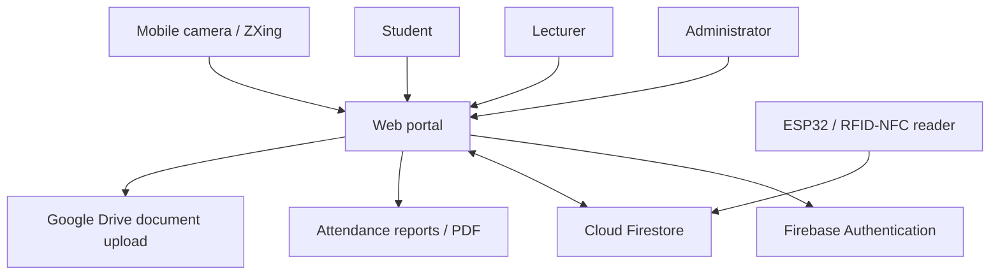

# Advanced Attendance System

A Diploma in Information Technology final-year project developed to simplify classroom attendance recording, monitoring, and reporting. The system combines a web portal for administrators, lecturers, and students with ESP32-based RFID/NFC attendance integration and a mobile camera-based barcode scanner.

**Project status:** Academic prototype (2025). This repository preserves the original student project for educational and portfolio review. It is not intended for production deployment.

## Live Demo

**[Open the Advanced Attendance System](https://advanceattendance.firebaseapp.com/)**

The hosted academic prototype may differ from the latest repository version. Some features require authentication or hardware configuration.

## Overview

Traditional classroom attendance involves manual record keeping, which can make it difficult to consolidate records, identify absences, and prepare reports. This project explores an integrated approach to student identification, scheduled class attendance, centralized records, and role-specific access to attendance information.

## Features

| User role | Functionality |
| --- | --- |
| Administrator | Manage student and lecturer records, courses, subjects, groups, classrooms, and timetables; review attendance statistics. |
| Lecturer | View scheduled classes, record attendance using NFC/RFID, mobile barcode scanning, or manual marking; review absence requests and generate attendance reports. |
| Student | View timetables and attendance information, submit absence requests (optional supporting documents require Google Drive configuration), and review request history and notifications. |

- Firebase email/password authentication and role-specific dashboard navigation.
- ESP32 attendance integration through card UID records stored in Cloud Firestore.
- Camera-based barcode scanning using ZXing, including checks for session membership and previously recorded attendance.
- Attendance filtering by course, subject, and session, with PDF export and printing.
- Absence request submission and lecturer approval/rejection workflows.
- Timetable management and scheduling conflict checks.

## Technology Stack

| Technology | Purpose |
| --- | --- |
| HTML, CSS, JavaScript | Browser-based interface and application logic |
| Firebase Authentication | Email/password sign-in |
| Cloud Firestore | User profiles, schedules, attendance, and absence records |
| Firebase Hosting | Web application hosting |
| ESP32 + RFID/NFC reader | Card-based attendance input; the web portal consumes scanned UID data |
| ZXing | Camera-based barcode recognition |
| Chart.js | Dashboard visualizations |
| jsPDF / AutoTable | Attendance report PDF export |
| Google Drive API | Optional supporting document upload integration |

## System Architecture



The browser-based application communicates directly with Firebase. The lecturer dashboard reads scanned card UIDs associated with a classroom, matches them against registered students, checks course and group membership, and records attendance for the selected session. Mobile scanning and manual attendance interfaces provide alternative input methods.

## Key Repository Files

```text
fyp-acmarrrr/
├── public/
│   ├── login.html               # Authentication and role navigation
│   ├── reset-password.html      # Password recovery page
│   ├── admin_dashboard.html     # Administration and timetable management
│   ├── lecturer_dashboard.html  # Lecturer workflows and NFC integration
│   ├── student_dashboard.html   # Student information and absence requests
│   ├── attendance.html          # Session attendance management
│   ├── mobile_attendance.html   # Mobile session selection
│   ├── barcode-scanner.html     # Camera-based attendance scanning
│   └── attendance_report.html   # Reporting and PDF export
├── firebase.json                # Firebase Hosting configuration
└── README.md
```

### Data Model

The web application uses Firestore collections including `user`, `admin`, `lecturer`, `student`, `course`, `class`, `attendance`, `absence`, `notifications`, and `ESP32`. Attendance is organized by course, subject, class session, and student. Scanned card UIDs are associated with classroom venues and matched against student records.

## Local Setup

This academic prototype is not a self-contained demo with a provisioned backend or sample accounts. Do not connect a test deployment to the original Firebase project or use real student records.

1. Clone the repository:

   ```bash
   git clone https://github.com/xinxinshen2/fyp-acmarrrr.git
   cd fyp-acmarrrr
   ```

2. Create your own Firebase project and web app. Enable email/password authentication and create a Cloud Firestore database.
3. Install Node.js 22 or newer. Copy the configuration template to a local `.env` file:

   Windows PowerShell:

   ```powershell
   Copy-Item .env.example .env
   ```

   macOS/Linux:

   ```bash
   cp .env.example .env
   ```

   Fill in the Firebase web app configuration from Firebase Console → Project settings → Your apps. Then generate the browser configuration:

   ```bash
   node scripts/configure.mjs
   ```

   The script writes `public/app-config.js`. Both `.env` and the generated file are ignored by Git. Run the script again after editing `.env`. Do not put secrets into frontend configuration. The browser necessarily receives Firebase web configuration and the optional OAuth client ID and folder ID.

   The original Firebase Hosting project/site references remain in `.firebaserc` and `firebase.json`. Replace or remove those references before deploying to a different project; always select your intended project explicitly.
4. Implement and verify restrictive Firestore security rules before enabling data access. Create authorized test accounts and synthetic role profiles, course records, and attendance sessions. Do not use public read/write rules.
5. Configure the optional Google Drive integration below if needed. Connect an independently configured ESP32 device if testing card-based attendance.
6. Install Node.js and the Firebase CLI, then serve the hosting files locally:

   ```bash
   npm install -g firebase-tools
   firebase emulators:start --only hosting --project YOUR_PROJECT_ID
   ```

   Open the local URL printed by the CLI and navigate to the login page. The hosting emulator alone does not emulate Authentication or Firestore; without additional emulator configuration, the Firebase SDK connects to the project specified in the HTML pages. Use a dedicated test project or explicitly configure the Auth and Firestore emulators. Camera access requires a supported browser and secure context (HTTPS or localhost).

A complete hardware firmware setup, database seed, deployed security configuration, and end-to-end test suite have not been verified.

## Environment Configuration

| Variable | Required | Where to obtain it |
| --- | --- | --- |
| `FIREBASE_API_KEY` | Yes | Firebase web app configuration |
| `FIREBASE_AUTH_DOMAIN` | Yes | Firebase web app configuration |
| `FIREBASE_PROJECT_ID` | Yes | Firebase web app configuration |
| `FIREBASE_APP_ID` | Yes | Firebase web app configuration |
| `FIREBASE_MESSAGING_SENDER_ID` | Yes | Firebase web app configuration |
| `FIREBASE_STORAGE_BUCKET` | No | Firebase web app configuration |
| `FIREBASE_DATABASE_URL` | No | Firebase Realtime Database URL, if applicable |
| `FIREBASE_MEASUREMENT_ID` | No | Firebase web app configuration, if applicable |
| `GOOGLE_DRIVE_CLIENT_ID` | No | Google Cloud OAuth 2.0 Web application client ID |
| `GOOGLE_DRIVE_FOLDER_ID` | No | Destination Drive folder ID accessible to the OAuth application |

### Optional Google Drive uploads

Enable Google Drive API in your own Google Cloud project, configure the OAuth consent screen and create a Web application OAuth client. Add the exact development or hosting origin to Authorized JavaScript origins. Fill in the client ID in `.env` and regenerate the browser configuration. The folder ID is optional; if omitted, Drive uses the signed-in user's default location. With the limited `drive.file` scope, the application must have access to the selected destination folder; an arbitrary folder ID alone does not grant access. Reviewers need appropriate file/folder access separately.

No Google API key or OAuth client secret is needed for the browser token flow. Never place an OAuth client secret, service account private key, access token, refresh token or real user password in this frontend configuration. If Drive is unconfigured, students can submit absence requests without attachments. Prior credentials in Git history must be revoked or rotated separately; removing them from the latest source does not revoke them.

## Known Limitations and Future Improvements

- Verify Firebase security rules and replace legacy hosting targets for independent deployments.
- Enforce role-based authorization and ownership checks through backend authorization or security rules rather than relying on browser session state.
- Replace the original default-password account creation flow with secure account provisioning and password setup.
- Validate attendance updates, handle concurrent writes, and ensure attendance and absence records remain consistent.
- Apply least-privilege permissions to supporting document uploads and protect student information.
- Improve camera device selection and pin external library versions for reproducibility.
- Refactor large HTML pages into reusable JavaScript modules and add automated tests.
- Document the hardware firmware, database setup, and demo data for reproducible installation.

## Academic Context

Developed as a Diploma in IT final-year project at Sunway College (2025). The project demonstrates web application development, cloud data integration, role-specific workflows, hardware-assisted attendance recording, and report generation.

This repository is provided for academic and portfolio review. No open-source license is asserted here; obtain permission from the relevant contributors before reusing or redistributing their work.
